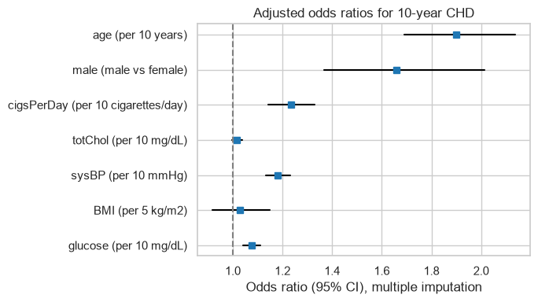
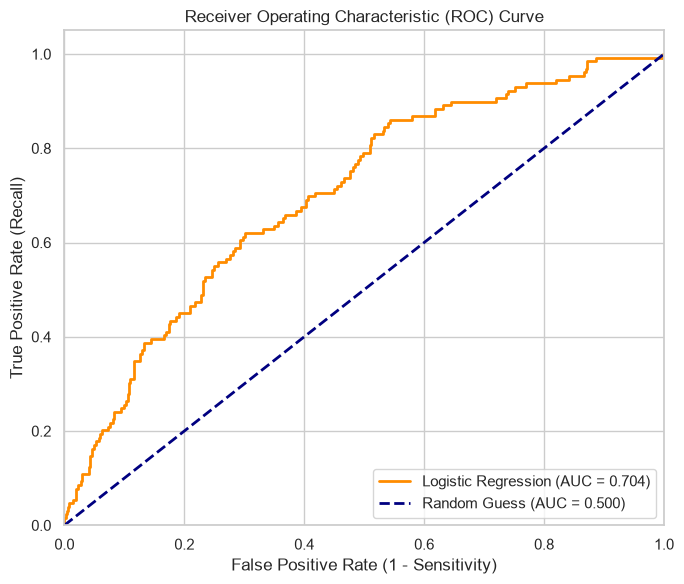
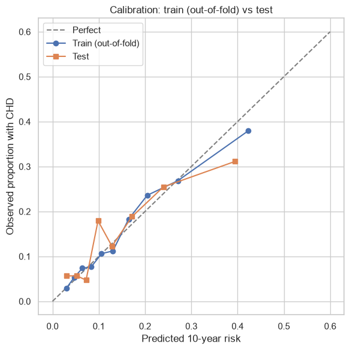

# Framingham Heart Study: Predicting 10-Year Coronary Heart Disease

**In short:** Age, sex, smoking, systolic blood pressure, and blood glucose were each independently associated with 10-year coronary heart disease (CHD). A seven-variable logistic regression predicted CHD with moderate discrimination (test ROC-AUC 0.704) and was reasonably well calibrated on average, but its positive predictive value was low (27%).

## Overview

This project asks how well baseline demographic and clinical characteristics explain and predict 10-year CHD in the Framingham Heart Study. It approaches the question in two ways:

- **Statistical inference:** Which baseline characteristics are independently associated with CHD, and how strongly?
- **Predictive modeling:** How accurately can a logistic regression model predict who develops CHD?

## Dataset

The project uses the Framingham Heart Study teaching dataset from [Kaggle](https://www.kaggle.com/datasets/aasheesh200/framingham-heart-study-dataset). It contains 4,240 participants and 16 columns. The outcome, `TenYearCHD`, is binary and marks whether the participant developed CHD within 10 years. **15.2% of participants (about 644) had the outcome.**

| Category | Variables |
|---|---|
| Demographics | Age, sex, education |
| Behavioral | Current smoker, cigarettes per day |
| Clinical | Systolic and diastolic blood pressure, total cholesterol, BMI, heart rate, glucose |
| History / treatment | Blood pressure medication, prevalent hypertension, prevalent stroke, diabetes |

**Missing data:** Glucose had the most missing values (388, 9.2%), followed by education (105), blood pressure medication (53), total cholesterol (50), cigarettes per day (29), BMI (19), and heart rate (1). Of the 4,240 participants, 3,803 had complete data on the model variables.

**Model variables:** The primary models use seven predictors: age, sex, cigarettes per day, total cholesterol, systolic blood pressure, BMI, and glucose. The other variables were tested only in sensitivity analyses (see below).

## Methodology

### Missing data
- **Inference:** Multiple imputation by chained equations (MICE) with 20 imputed datasets. Results were pooled using Rubin's rules. Complete-case and single-imputation results are shown for comparison.
- **Prediction:** The imputer was fit inside a scikit-learn pipeline, so it only learned from training data in each fold. This prevents information from the test set leaking into the model.

### Statistical inference
A multivariable logistic regression was fit on the seven predictors. Odds ratios are scaled to clinically meaningful increments and reported with 95% confidence intervals and p-values.

### Predictive modeling
- **Split:** 80/20 stratified train/test split (848 test participants, 129 with CHD).
- **Validation:** 5-fold stratified cross-validation on the training set.
- **Metrics:** ROC-AUC (with bootstrap CI), Brier score, calibration slope and intercept, calibration curves, and sensitivity, specificity, PPV, and NPV.
- **Threshold:** 0.154, chosen by maximizing Youden's J on out-of-fold training predictions, so the test set played no role in the choice.

### Sensitivity analyses
- Adding prevalent hypertension, diabetes, blood pressure medication, diastolic BP, prevalent stroke, and heart rate to the model.
- Adding spline terms for age, systolic BP, and glucose.
- Replacing logistic regression with shallow gradient boosting.
- Testing an age × systolic BP interaction.

## Key Findings

### Which factors are associated with CHD?

Adjusted odds ratios (multiple imputation, pooled):

| Predictor | Odds ratio (95% CI) | p |
|---|---|---|
| Age (per 10 years) | 1.90 (1.69–2.14) | <0.001 |
| Male vs. female | 1.66 (1.37–2.01) | <0.001 |
| Cigarettes (per 10/day) | 1.23 (1.14–1.33) | <0.001 |
| Systolic BP (per 10 mmHg) | 1.18 (1.13–1.23) | <0.001 |
| Glucose (per 10 mg/dL) | 1.08 (1.04–1.11) | <0.001 |
| Total cholesterol (per 10 mg/dL) | 1.02 (1.00–1.04) | 0.103 |
| BMI (per 5 kg/m²) | 1.03 (0.92–1.15) | 0.635 |

Total cholesterol and BMI were not significantly associated with CHD after adjustment. Estimates were nearly identical across complete-case, single-imputation, and multiple-imputation analyses, so the conclusions are not sensitive to how missing data were handled.

### How well does the model predict CHD?

| Metric | Result |
|---|---|
| Cross-validated ROC-AUC (training) | 0.732 ± 0.031 |
| Test ROC-AUC | 0.704 (95% bootstrap CI 0.654–0.748) |
| Brier score | 0.121 (0.129 for a model that always predicts the average risk) |
| Calibration slope (test) | 0.80 (95% CI 0.60–1.01); ideal is 1.0 |
| Sensitivity / specificity (threshold 0.154) | 62.0% / 69.3% |
| PPV / NPV (threshold 0.154) | 26.6% / 91.0% |

- **Discrimination is moderate.** The model ranks higher-risk individuals above lower-risk ones more often than chance, but it is far from a clinical-grade classifier.
- **Calibration is good on average but imperfect.** Mean predicted risk matched observed risk (14.9% vs. 15.2% on the test set). A test slope below 1 suggests predictions at the extremes are somewhat too extreme.
- **PPV is low.** At the chosen threshold, only about 1 in 4 flagged participants developed CHD, while a negative result was reassuring (NPV 91%). This is partly a consequence of the 15% prevalence.
- **Added complexity did not help.** Extra clinical variables raised cross-validated AUC by less than 0.001, spline terms gave +0.001, gradient boosting was lower (0.720 vs. 0.732), and the age × systolic BP interaction was not significant (p = 0.36). The simple seven-variable model is about as good as these alternatives.

### Points-based score and risk calculator
The notebook also converts the model into a simple points score (AUC 0.727 vs. 0.730 for the full model, in-sample) and includes a command-line risk calculator for educational use.

## Limitations

- **Observational data:** Associations cannot be interpreted as causal.
- **Missing data:** Imputation assumes data are missing at random, which cannot be verified. Glucose, the variable with the most missing values, is also a significant predictor.
- **No external validation:** Performance was evaluated only on held-out data from the same cohort, so it likely overstates accuracy in new populations.
- **Generalizability:** The Framingham cohort comes from a single Massachusetts community and was largely white, so findings may not transfer to other populations.
- **Threshold dependence:** Sensitivity, specificity, and PPV change with the cutoff, and a different clinical goal would call for a different threshold.
- **Baseline measurements only:** Changes in risk factors over time were not captured.
- **Wide uncertainty on the test set:** With only 129 events, the test AUC confidence interval spans about 0.65 to 0.75.

## Tools

Python with pandas, NumPy, statsmodels, scikit-learn, matplotlib, and seaborn.

## Reproducing the Analysis

1. Download `framingham.csv` from the Kaggle link above and place it in the project folder.
2. Install the dependencies: `pip install pandas numpy statsmodels scikit-learn matplotlib seaborn scipy`
3. Run the notebook top to bottom.
